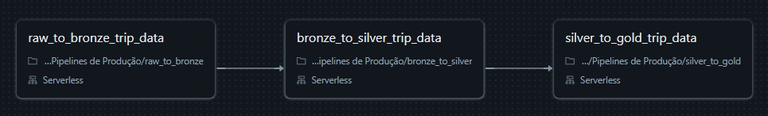
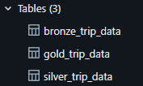
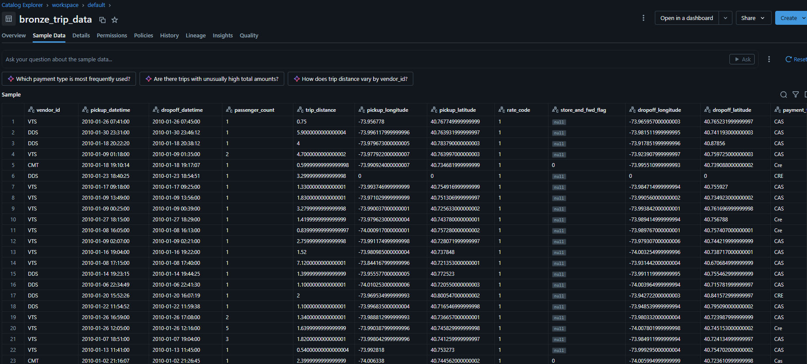
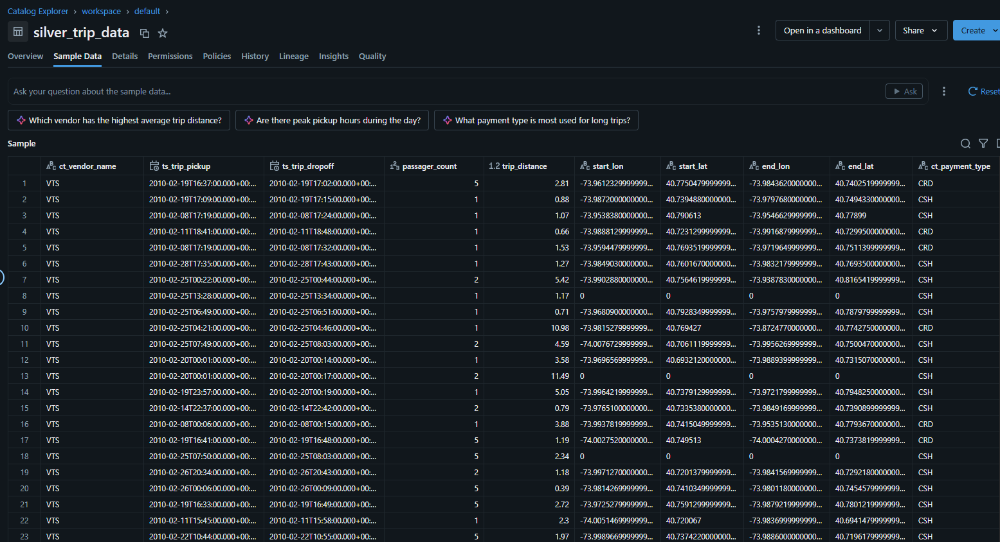
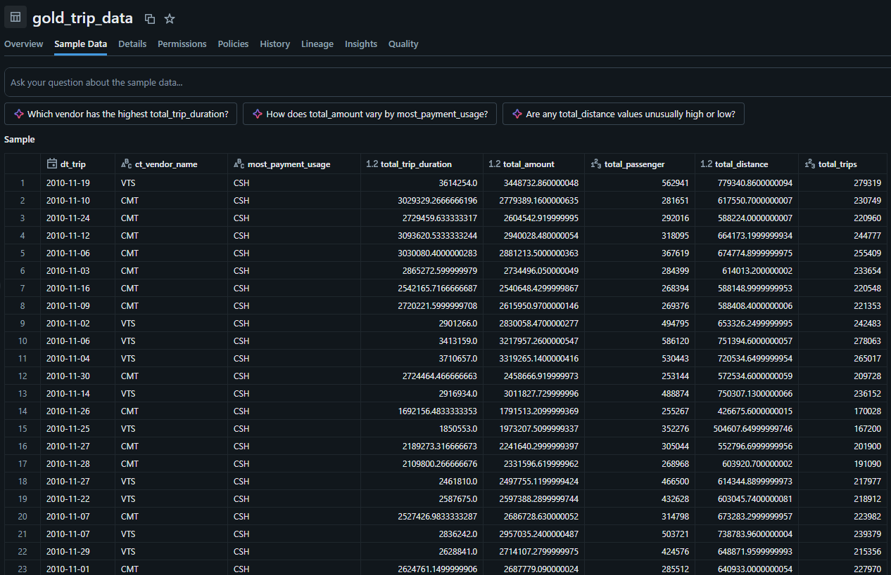

# Pipeline de Dados de Táxi com Arquitetura Medalhão | Databricks

## Sobre o projeto

Este projeto consiste no desenvolvimento de um pipeline de dados utilizando o **Databricks**, seguindo a arquitetura Medalhão (Medallion Architecture), composta por três camadas: Bronze, Silver e Gold.

O objetivo é organizar o processamento dos dados em diferentes etapas, desde a ingestão dos dados brutos até a geração de informações agregadas, além de automatizar a execução do pipeline utilizando o recurso **Workflows do Databricks**.

Para o desenvolvimento, foram utilizados dados de viagens de táxi de Nova York (NYC Taxi), disponibilizados pelo próprio Databricks.

## Tecnologias utilizadas

- **Databricks:** ambiente de desenvolvimento e processamento dos dados.
- **Apache Spark / PySpark:** leitura, transformação e processamento dos dados.
- **Python:** linguagem utilizada no desenvolvimento dos notebooks.
- **Databricks Workflows:** orquestração e automação do pipeline.
- **Arquitetura Medalhão:** organização dos dados em camadas Bronze, Silver e Gold.

## Arquitetura do projeto

O pipeline foi dividido em três notebooks, cada um responsável por uma etapa do processamento:

### 1. Bronze — Raw to Bronze

Nesta primeira etapa, os dados são extraídos diretamente dos arquivos CSV disponibilizados pelo Databricks.

O notebook recebe parâmetros de ano, mês e contexto (tipo de arquivo), utilizados para localizar os dados de origem.

**Principais atividades:**
- Leitura dos arquivos CSV de viagens de táxi.
- Utilização de parâmetros para definir quais arquivos serão processados.
- Armazenamento dos dados na tabela `bronze_trip_data`.
- Preservação dos dados originais, sem aplicação de transformações.
- Armazenamento das colunas como strings.

A camada Bronze funciona como a primeira etapa de armazenamento dos dados, mantendo as informações próximas ao formato original.

### 2. Silver — Bronze to Silver

Nesta etapa, os dados armazenados na camada Bronze passam por um processo de limpeza e transformação.

**Principais atividades:**
- Renomeação das colunas para padronizar os nomes.
- Conversão dos tipos de dados, como datas, números inteiros e decimais.
- Padronização dos nomes das colunas.
- Criação da coluna `pk_trip`, utilizada como identificador de cada registro.
- Criação da coluna `trip_duration_in_min`, que calcula a duração da viagem em minutos.
- Armazenamento dos dados tratados na tabela `silver_trip_data`.

A camada Silver tem como objetivo disponibilizar dados mais organizados, padronizados e prontos para análises posteriores.

### 3. Gold — Silver to Gold

Na última etapa, os dados da camada Silver são utilizados para gerar informações agregadas, organizadas para facilitar análises.

**Principais atividades:**
- Agrupamento dos dados por data da viagem e empresa responsável (vendor).
- Cálculo da duração total das viagens.
- Soma dos valores das viagens.
- Soma da quantidade de passageiros.
- Soma das distâncias percorridas.
- Contagem do total de viagens.
- Identificação do tipo de pagamento mais utilizado por dia e por empresa, utilizando Window Functions e a função `rank()`.

Ao final, as informações são combinadas e armazenadas na tabela `gold_trip_data`.

A camada Gold disponibiliza dados consolidados, facilitando consultas e análises de negócio.

## Automação com Databricks Workflows

Após o desenvolvimento dos três notebooks, foi criado um Workflow no Databricks para automatizar a execução do pipeline.

O Workflow organiza as tarefas na sequência correta, respeitando as dependências entre as camadas:

1. Raw to Bronze
2. Bronze to Silver
3. Silver to Gold

Foram definidos parâmetros nos três notebooks utilizando `dbutils.widgets`, que permitem receber valores externos e reutilizar os mesmos notebooks em diferentes execuções.

Esses parâmetros também podem ser configurados diretamente no Workflow, permitindo alterar os valores de execução sem precisar modificar o código dos notebooks.

## Estratégia de escrita dos dados

Neste projeto, foi utilizado o modo `overwrite` para gravação das tabelas.

Na prática, isso significa que os dados existentes são substituídos pelos novos dados a cada execução.

Como exemplo:
- Na primeira execução do Workflow, foram processados os dados referentes ao ano de 2009.
- Na execução seguinte, foram processados os dados de 2010, substituindo os dados anteriores.

Essa estratégia foi adotada exclusivamente para fins de aprendizado e demonstração do funcionamento dos parâmetros e da automação do pipeline.

Em cenários reais, a estratégia de escrita deve ser definida de acordo com as necessidades do negócio e as características dos dados, podendo envolver outras abordagens, como cargas incrementais.

## Resultado final

Ao término da execução do Workflow, são geradas três tabelas, correspondentes às camadas da arquitetura Medalhão:

| Camada | Tabela | Descrição |
|---|---|---|
| Bronze | `bronze_trip_data` | Dados brutos extraídos da origem. |
| Silver | `silver_trip_data` | Dados tratados, padronizados e enriquecidos. |
| Gold | `gold_trip_data` | Dados agregados para facilitar análises. |

  

### Exemplos dos dados gerados

**Tabela Bronze — Dados originais**

- Dados extraídos diretamente da fonte original.
- Preservação de todas as colunas disponíveis.
- Colunas armazenadas como texto (StringType), sem transformações.

**Tabela Silver — Dados tratados**

- Renomeação e padronização das colunas.
- Conversão dos tipos de dados, como datas, números inteiros e decimais.
- Seleção das colunas de interesse.
- Criação de novas colunas: pk_trip e trip_duration_in_min.

**Tabela Gold — Dados agregados**

- Agrupamento dos dados por data da viagem e empresa responsável.
- Aplicação de agregações, como soma e contagem.
- Identificação do tipo de pagamento mais utilizado por dia e por empresa, utilizando Window Functions.
- Consolidação dos resultados em uma tabela voltada para análises.
  
## Aprendizados e conceitos aplicados

Durante o desenvolvimento deste projeto, foram trabalhados os seguintes conceitos:

- Arquitetura Medalhão (Bronze, Silver e Gold).
- Ingestão e leitura de arquivos CSV.
- Processamento de dados com PySpark.
- Renomeação e conversão de tipos de colunas.
- Criação de novas colunas e enriquecimento dos dados.
- Agregações com `groupBy()` e `agg()`.
- Utilização de Window Functions.
- Utilização de parâmetros com `dbutils.widgets`.
- Gravação de tabelas com `saveAsTable()`.
- Orquestração e automação de pipelines com Databricks Workflows.
- Execução de cargas utilizando a estratégia `overwrite`.

## Considerações finais

Este projeto foi desenvolvido como parte dos estudos em Engenharia de Dados, com foco na aplicação prática dos fundamentos de construção e organização de pipelines de dados.

A proposta foi compreender cada etapa do processamento, desde a ingestão dos dados até a disponibilização de informações agregadas, além de conhecer os recursos de parametrização e automação oferecidos pelo Databricks.
